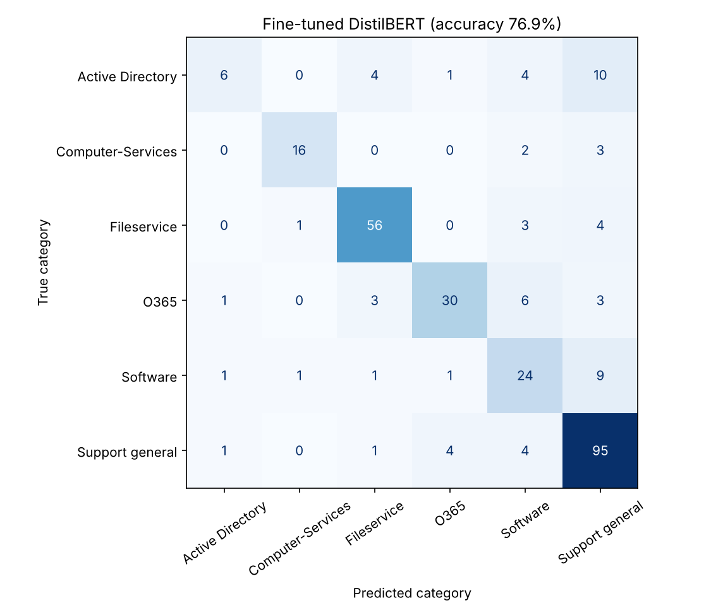
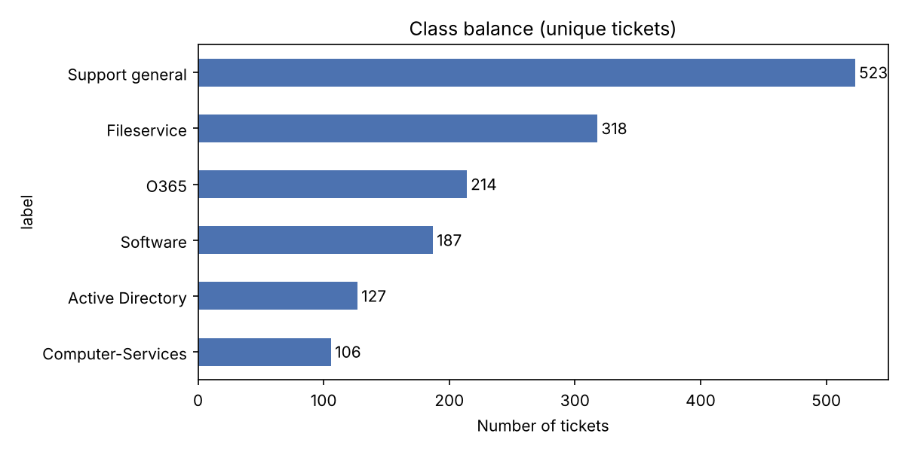

# Support ticket classifier: fine-tuned DistilBERT vs. Claude

Routes IT support tickets to the right team. I fine-tuned a small transformer
(DistilBERT, 66M parameters) with PyTorch on real helpdesk tickets, served it behind
a FastAPI endpoint, and compared it with calling a large LLM (Claude Opus 5.5)
on the same held-out test set.

## The problem

A helpdesk receives free-text tickets ("Outlook won't open the shared mailbox",
"File Share Access - [NAME]") and someone has to decide which team handles each
one. Doing that by hand is slow and inconsistent. The question this project asks:
for a routing task with company-specific categories, is it better to train your own
small model or to send each ticket to a general-purpose LLM API?

## Results

Test set: 295 tickets the models never saw during training. 270 of them have no
near-duplicate in the training data (the "novel tickets" column).

| Model | Accuracy | Macro F1 | Accuracy on novel tickets | Median latency | p95 latency | Cost for the 295 tickets |
|---|---|---|---|---|---|---|
| **Fine-tuned DistilBERT** (CPU, 4 threads) | **76.9%** | **0.705** | **76.3%** | **16 ms** | **33 ms** | $0 per request (own hardware) |
| Claude Opus 5.5, zero-shot | 62.4% | 0.637 | 64.4% | 1,339 ms | 3,186 ms | $0.27 ($0.93 per 1,000 tickets) |
| Claude Opus 5.5, few-shot (18 examples) | 66.4% | 0.685 | 68.1% | 812 ms | 2,083 ms | $0.41 ($1.40 per 1,000 tickets) |

Per-category F1 (higher is better):

| Category | Fine-tuned DistilBERT | Claude zero-shot | Claude few-shot |
|---|---|---|---|
| Active Directory | 0.35 | 0.40 | **0.47** |
| Computer-Services | 0.82 | 0.86 | **0.91** |
| Fileservice | 0.87 | **0.94** | **0.94** |
| O365 | **0.76** | 0.65 | 0.67 |
| Software | 0.60 | 0.51 | **0.64** |
| Support general | **0.83** | 0.46 | 0.48 |

How these were measured:

- **Accuracy**: share of test tickets labeled correctly. **Macro F1**: the F1 score
  averaged over the six categories equally, so small categories count as much as
  big ones (the classes are imbalanced, see below).
- **Latency**: one ticket per request, timed end to end. DistilBERT runs locally on
  CPU; Claude's time includes the network round trip. Claude ran with 8 requests in
  parallel; effort was set to `low` and the shared instructions were prompt-cached.
- **Cost**: computed from the token counts the API returned for every request, at
  Anthropic list prices (Nov 2026: $4 / $20 per million input / output tokens, $0.20
  per million cached input tokens). The fine-tuned model has no per-request fee,
  but hosting it on a server is not free.
- Fine-tuning took **6.1 minutes on a 4-core CPU**, no GPU. The saved model is 269 MB.

### Confusion matrix (fine-tuned model)

Rows are the true category, columns what the model predicted. The diagonal is correct.



The Claude confusion matrices are in [`reports/`](reports/).

### What the numbers say

- **The fine-tuned model wins overall, mainly on "Support general".** This company
  files many tickets that *sound* like account or mailbox work under its catch-all
  category. For example, "Create Windows account for external user" and "Create
  Shared Mailbox" are both labeled *Support general*. Claude reasonably calls them
  *Active Directory* and *O365*; the fine-tuned model learned the house convention
  from the labeled examples. Claude's recall on Support general is about 35%;
  DistilBERT's is 90%.
- **On macro F1 the race is close.** Because macro F1 weights all six categories
  equally, the big Support general gap matters less there: 0.705 for DistilBERT vs
  0.685 for few-shot Claude, a difference within noise for a 295-ticket test set.
  The accuracy lead (76.9% vs 66.4%) comes mostly from the largest category.
- **Claude is better on several specific categories** (Active Directory, Computer-Services,
  Fileservice) and needs zero training data. Adding 18 labeled examples to the
  prompt raised its accuracy by 4 points, but a handful of examples can't teach
  every house rule.
- **Active Directory is the fine-tuned model's weak spot** (recall 24%). It's a small
  class (102 training tickets), and the model pushes uncertain tickets toward the
  large Support general class.
- **The labels themselves are noisy.** Tickets about leaving employees, for example,
  appear under both Active Directory and Support general. Some errors for both
  models are arguably labeling disagreements, so no model will reach 100% here.
- **Template leakage is small.** Many tickets are auto-generated templates. Only 25
  of 295 test tickets have a near-duplicate in the training set, and accuracy on the
  other 270 (76.3%) is close to the headline number.
- **Cost is not the deciding factor at this volume.** At $0.93 per 1,000 tickets,
  even 10,000 tickets a month is about $9 with Claude. The bigger differences are
  accuracy on this company's own categories, speed (16 ms vs ~1 s), and keeping
  ticket text in-house.

## Dataset

[`tasksource/it-support-tickets`](https://huggingface.co/datasets/tasksource/it-support-tickets)
on Hugging Face, originally *Classification of IT Support Tickets* by Leonardo Santiago
Benitez Pereira (DOI [10.5281/zenodo.7648117](https://doi.org/10.5281/zenodo.7648117)),
licensed [CC BY 4.0](https://creativecommons.org/licenses/by/4.0/). These are **real
tickets** from an IT support company in Brazil, labeled by three IT support
professionals. Personal data was masked by the authors (`[NAME]`, `[EMAIL]`,
`[TICKET ID]`, ...). Text is mostly English, with some German, Portuguese and Spanish.

What I changed (`src/prepare_data.py`):

1. Combined the original train and test files (2,229 rows).
2. **Removed exact duplicates**, which left 1,477 unique tickets. Many tickets are
   automated messages repeated word for word; leaving copies on both sides of the
   split would inflate test scores. One text had conflicting labels; I kept the
   majority label.
3. **Dropped the "EOL" category**: every EOL ticket is the same automated
   message, so only 2 unique examples remain, too few to train or test on.
4. Made a fresh, **stratified 80/20 split** (seed 42): 1,180 train / 295 test.
   Both models are scored on the same `data/test.csv`.

Class balance (unique tickets):

| Category | Tickets | Share |
|---|---|---|
| Support general | 523 | 35.5% |
| Fileservice | 318 | 21.6% |
| O365 | 214 | 14.5% |
| Software | 187 | 12.7% |
| Active Directory | 127 | 8.6% |
| Computer-Services | 106 | 7.2% |



## Approach

**Fine-tuned model** (`src/train.py`): `distilbert-base-uncased` with a new 6-way
classification head, trained with the Hugging Face `Trainer` (PyTorch backend):
3 epochs, batch size 16, learning rate 5e-5 with 10% warmup, weight decay 0.01,
max 128 tokens (12.3% of tickets are longer and get truncated). Training loss fell
from 1.78 to about 0.55–0.60. No hyperparameter search was done, and the test set
was not used for any training decision.

**LLM baseline** (`src/llm_baseline.py`): Claude Opus 5.5 through the official
`anthropic` Python SDK. The system prompt lists the six categories with a one-line
description of each, written from the category names and training examples (never
tuned on the test set). Structured outputs constrain the reply to JSON whose
`category` must be one of the six labels, so there are no parsing failures. The
few-shot variant adds 3 random training tickets per category. The API key is read
from the `ANTHROPIC_API_KEY` environment variable. Server-side refusal fallback is
enabled; it was never triggered (0 refusals, 0 errors).

**Serving** (`src/api.py`): FastAPI app that loads the model once at startup and
exposes `POST /classify`.

## How to run it

Requires Python 3.10+. Everything runs on a CPU; a GPU is used automatically if present.

```bash
python -m venv .venv
source .venv/bin/activate          # Windows: .venv\Scripts\activate
pip install -r requirements.txt    # on a GPU machine, delete the first line of the file first

python src/prepare_data.py         # download + clean data -> data/*.csv
python src/train.py                # fine-tune (~6 min on a 4-core CPU) -> models/
python src/evaluate.py             # metrics + confusion matrix -> reports/

export ANTHROPIC_API_KEY=...       # your own key; never commit it
python src/llm_baseline.py --mode zero-shot --limit 5    # cheap check first
python src/llm_baseline.py --mode zero-shot
python src/llm_baseline.py --mode few-shot
python src/compare.py              # side-by-side table -> reports/results.md

pytest                             # 16 tests; model tests are skipped if models/ is empty
```

Serve the model:

```bash
uvicorn src.api:app --port 8000
curl -X POST localhost:8000/classify \
  -H 'Content-Type: application/json' \
  -d '{"text": "Please grant me read access to the finance share on the file server"}'
# {"category":"Fileservice","confidence":0.9463,"scores":{...}}
```

Interactive API docs are at http://localhost:8000/docs. The trained model is not
committed (269 MB); `python src/train.py` recreates it.

## Project structure

```
data/        tickets.csv, train.csv, test.csv
src/
  prepare_data.py   download, dedupe, split
  train.py          fine-tune DistilBERT
  predict.py        TicketClassifier: load model, predict
  evaluate.py       score the fine-tuned model
  llm_baseline.py   score Claude on the same test set
  metrics.py        shared scoring + confusion matrix code
  compare.py        build the results table
  api.py            FastAPI app
tests/       API tests (fake model) + prediction tests (real model)
reports/     metrics JSON, predictions CSV, confusion matrices
```

## Limitations

- One run with one random seed. With 295 test tickets, differences of 2–3
  points are within noise; the gap between DistilBERT and Claude zero-shot (14
  points) is not.
- `distilbert-base-uncased` was trained on English text only. The non-English
  tickets are a disadvantage for it, and Claude handles them natively.
- The test set is small for the minority classes (21–25 tickets each), so
  per-class numbers there are rough.
- Claude latency depends on network conditions and API load at the time of the run.
- The confidence score is the model's softmax probability. It is not calibrated, so
  "0.8" doesn't mean "right 80% of the time".

## What I'd improve next

1. **Fix the class imbalance**: class-weighted loss or oversampling, to lift Active
   Directory recall above 24%.
2. **Tune training honestly**: carve a validation split out of the training data and
   use it to pick epochs and learning rate (loss was still falling at epoch 3).
3. **Try a multilingual base model** (e.g. `distilbert-base-multilingual-cased` or
   `xlm-roberta-base`), since some tickets aren't in English.
4. **Route by confidence**: send low-confidence predictions to a human or to Claude.
   For example, "My laptop is very slow and the printer is jammed" comes back as
   *Software* with only 27% confidence; it should be *Computer-Services*.
5. **Test a cheaper LLM** (Claude Haiku 5.5 is ~40x cheaper per token than Opus) and
   more few-shot examples, to see where the LLM cost/accuracy curve flattens.
6. **Repeat with several seeds / cross-validation** to put error bars on the numbers.
7. **Clean the labels**: review the tickets both models get wrong; some are likely
   mislabeled.

## Attribution

Dataset: Leonardo Santiago Benitez Pereira, *Classification of IT Support Tickets*,
Zenodo, 2022, DOI 10.5281/zenodo.7648117, CC BY 4.0. Redistributed here in cleaned
form (deduplicated, EOL class removed) under the same license.
